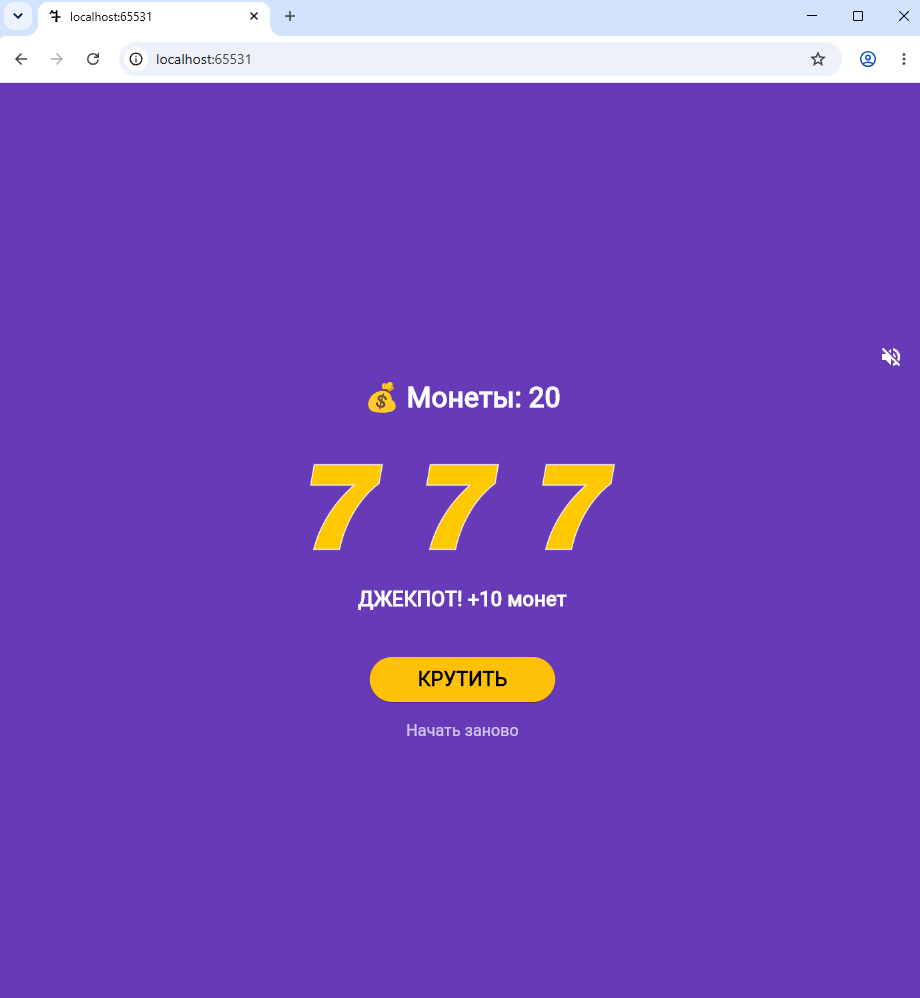
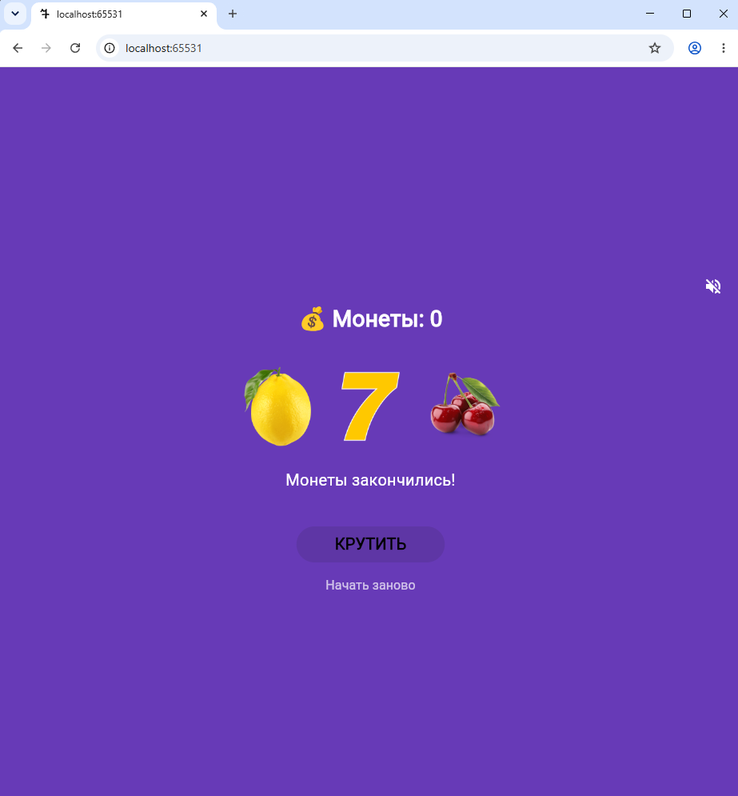

# Лабораторная работа №10. Слот-машина
Автор: Домрачева Полина 

Группа: ИСП-241 

Дата: 13.11.2026

| Главный экран | Результат | Монеты закончились |
| --- | --- | --- |
|  |  |  |
- Запуск:
git clone https://github.com/chipollina/Flutter_Lab10.git
cd slot_machine_domracheva
`flutter pub get `
Запустить в браузере (Web) `flutter run -d chrome` 
Запустить на Android `flutter run -d ID_устройства`.
- Звук включается отдельной кнопкой; до её нажатия приложение молчит.
- Сборка Android: `flutter build apk --release`.
- Готовый файл: `build/app/outputs/flutter-apk/app-release.apk`.
- APK: [Ссылка на файл в GitHub Releases](https://github.com/chipollina/Flutter_Lab10/releases/download/v1.0/app-release.apk)
- Проверенные Flutter/Dart:Flutter 3.47.9 Dart 3.13.7.
- Изучено: 
1. Состояние и анимация (`StatefulWidget`, `setState()`, `AnimatedOpacity`, `AnimatedSwitcher`).

2. Работа с локальными ресурсами (изображения и звуки через `pubspec.yaml`).

3. Аудиофокус и жизненный цикл приложения (остановка музыки при сворачивании, `WidgetsBindingObserver`).

4. Освобождение ресурсов (корректный `dispose()` для плееров).

5. Настройка иконок приложения (`flutter_launcher_icons`).

6. Сборка release-версий для Web и Android (APK).